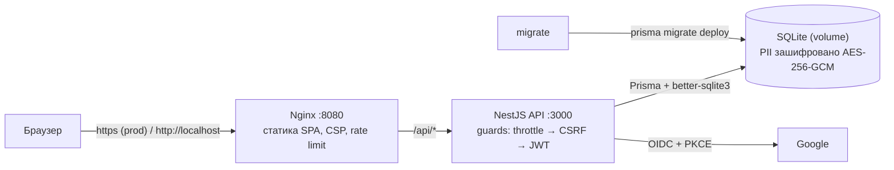

# YET TO BE

Каркас веб-застосунку з авторизацією (email + пароль і Google), профілем і порожньою головною сторінкою.
Монорепозиторій: NestJS API (`apps/api`) + React/Vite (`apps/web`) + спільні пакети (`packages/*`).

## Запуск за 5 команд

Потрібні Node.js ≥ 22.12 (`.nvmrc`) і [gitleaks](https://github.com/gitleaks/gitleaks) (pre-commit).

```bash
corepack enable          # pnpm 10 з "packageManager"
pnpm install
pnpm secrets:generate    # .env з випадковими секретами (існуючий не перезаписує)
pnpm db:migrate          # локальна SQLite-БД у apps/api/data
pnpm dev                 # web: http://localhost:5173, API: :3000 (через проксі Vite /api)
```

Для входу через Google впишіть у `.env` `GOOGLE_CLIENT_ID` і `GOOGLE_CLIENT_SECRET` з Google Cloud Console
(redirect URI: `http://localhost:5173/api/v1/auth/google/callback`).

## Архітектура



- Токени — лише в httpOnly cookies, фронтенд і API на одному origin (без CORS). Див. [ADR 0003](docs/adr/0003-cookies-not-localstorage.md).
- Email та ім'я зашифровані на рівні полів, пошук — через blind index. Див. [ADR 0004](docs/adr/0004-field-level-encryption.md).
- Спільні Zod-схеми й коди помилок — `packages/shared`; одна схема валідує і форму, і запит.
- Рішення та план зростання: [docs/adr](docs/adr/README.md), [docs/scaling.md](docs/scaling.md).

## Змінні оточення

Шаблон — `.env.example`; `pnpm secrets:generate` заповнює секрети. API перевіряє все при старті (Zod) і не
стартує з невалідною конфігурацією; у помилці — лише назви змінних, ніколи значення.

| Змінна                                                                                         | Обов'язкова | За замовчуванням    | Опис                                                                                                                         |
| ---------------------------------------------------------------------------------------------- | ----------- | ------------------- | ---------------------------------------------------------------------------------------------------------------------------- |
| `NODE_ENV`                                                                                     | ні          | `development`       | `development` / `test` / `production`                                                                                        |
| `APP_URL`                                                                                      | так         | —                   | Публічна адреса застосунку. У production — https (виняток: localhost). Від протоколу залежать `Secure` і `__Host-` у cookies |
| `API_PORT`                                                                                     | ні          | `3000`              | Порт API                                                                                                                     |
| `API_PREFIX`                                                                                   | ні          | `api`               | Префікс маршрутів (`/api/v1/...`)                                                                                            |
| `TRUST_PROXY`                                                                                  | ні          | `false`             | `true`, якщо API за одним проксі (Nginx): реальна IP з `X-Forwarded-For`                                                     |
| `THROTTLE_DISABLED`                                                                            | ні          | `false`             | Лише тести/E2E. У production заборонено                                                                                      |
| `OAUTH_MOCK`                                                                                   | ні          | `false`             | Лише E2E: mock замість Google. У production заборонено                                                                       |
| `DATABASE_URL`                                                                                 | так         | —                   | `file:./data/yettobe.db` (відносно `apps/api`)                                                                               |
| `JWT_ACCESS_SECRET`                                                                            | так         | —                   | ≥ 64 символи, секрет                                                                                                         |
| `JWT_ACCESS_TTL`                                                                               | так         | —                   | TTL access-токена, напр. `15m`                                                                                               |
| `JWT_ISSUER`, `JWT_AUDIENCE`                                                                   | так         | —                   | `iss` / `aud` у JWT                                                                                                          |
| `REFRESH_TOKEN_TTL_DAYS`                                                                       | ні          | `30`                | Життя refresh-токена                                                                                                         |
| `PASSWORD_PEPPER`                                                                              | так         | —                   | ≥ 32 символи, секрет                                                                                                         |
| `COOKIE_SECRET`                                                                                | так         | —                   | ≥ 32 символи, підпис OAuth-cookie                                                                                            |
| `DATA_ENCRYPTION_KEYS`                                                                         | так         | —                   | JSON `{"k1":"<base64 32 байти>"}`, секрет                                                                                    |
| `DATA_ENCRYPTION_ACTIVE_KEY_ID`                                                                | так         | —                   | Яким ключем шифрувати нові записи                                                                                            |
| `BLIND_INDEX_KEY`                                                                              | так         | —                   | base64, 32 байти, секрет                                                                                                     |
| `GOOGLE_CLIENT_ID`, `GOOGLE_CLIENT_SECRET`                                                     | так         | —                   | Google OAuth; у production без `change-me`                                                                                   |
| `GOOGLE_CALLBACK_URL`                                                                          | так         | —                   | `<APP_URL>/api/v1/auth/google/callback`                                                                                      |
| `VITE_PUBLIC_APP_NAME`                                                                         | ні          | `YET TO BE`         | Публічна, потрапляє в бандл. Секретів з `VITE_PUBLIC_` не буває                                                              |
| `YTB_PUBLIC_URL`, `YTB_HTTP_PORT`, `YTB_ENV_FILE`, `YTB_API_IMAGE`, `YTB_WEB_IMAGE`, `YTB_TAG` | ні          | див. `.env.example` | Лише для `docker-compose.yml`, у застосунок не йдуть                                                                         |

## Команди

| Команда                                                | Що робить                                                      |
| ------------------------------------------------------ | -------------------------------------------------------------- |
| `pnpm dev`                                             | API і web у watch-режимі                                       |
| `pnpm build`                                           | Збірка всіх пакетів (web + перевірка `dist/` на секрети)       |
| `pnpm lint` / `pnpm typecheck`                         | ESLint / TypeScript                                            |
| `pnpm test`                                            | Усі Vitest-тести (unit + integration)                          |
| `pnpm test:unit` / `pnpm test:int`                     | Лише unit / лише integration API                               |
| `pnpm test:cov`                                        | Тести з порогами покриття (падає, якщо нижче)                  |
| `pnpm test:all`                                        | lint + typecheck + test:cov + build — повна перевірка перед PR |
| `pnpm test:e2e`                                        | Playwright (Chromium, Firefox, WebKit) проти запущеного стеку  |
| `pnpm stack:up` / `pnpm stack:e2e` / `pnpm stack:down` | Docker-стек: production / E2E-режим / зупинка                  |
| `pnpm stack:wait`                                      | Чекає, доки стек на :8080 стане ready                          |
| `pnpm check:headers`                                   | Перевіряє захисні заголовки стеку на :8080                     |
| `pnpm secrets:generate` / `pnpm secrets:scan`          | Створити `.env` / gitleaks по репозиторію                      |
| `pnpm db:migrate` / `pnpm db:migrate:deploy`           | Міграція (dev) / застосувати готові (prod)                     |
| `pnpm db:seed` / `pnpm db:studio` / `pnpm db:reset`    | Seed / Prisma Studio / скинути dev-БД                          |
| `pnpm db:backup`                                       | Онлайн-бекап SQLite у `apps/api/data/backups`                  |

## Тестування

| Рівень          | Інструменти                                                     | Де                                          | Поріг                                               |
| --------------- | --------------------------------------------------------------- | ------------------------------------------- | --------------------------------------------------- |
| Unit            | Vitest                                                          | `*.spec.ts` / `*.test.ts(x)` поруч із кодом | ≥ 80% рядків; `src/auth` і `src/infra/crypto` ≥ 90% |
| Integration API | Vitest + Supertest + тимчасова SQLite на файл                   | `apps/api/test/integration`                 | усі ендпоінти                                       |
| Component       | Vitest + Testing Library + MSW (`onUnhandledRequest: 'error'`)  | `apps/web/src/**/*.test.tsx`                | ≥ 80%                                               |
| E2E             | Playwright × 3 браузери проти docker compose                    | `apps/web/e2e`                              | 8 критичних сценаріїв                               |
| Security        | gitleaks, check-dist-secrets, check-headers, ZAP, Trivy, CodeQL | CI                                          | 0 high / critical                                   |

E2E локально (потрібен Docker):

```bash
pnpm stack:e2e && pnpm stack:wait
pnpm --filter web test:e2e:install     # браузери Playwright, один раз
pnpm test:e2e
pnpm test:e2e -- --repeat-each=10      # перевірка на flaky
pnpm stack:down
```

## Docker

```bash
pnpm stack:up        # = docker compose up -d --build → http://localhost:8080
```

- `migrate` застосовує міграції й завершується; `api` стартує після нього; `web` (Nginx) — коли API healthy.
- Назовні відкритий лише Nginx; API — у внутрішній мережі. Контейнери non-root, `read_only`, `cap_drop: ALL`,
  `no-new-privileges`. Секрети — з `.env` на хості, в образах їх немає.
- Production-режим вимагає справжніх Google-ключів у `.env` і redirect URI `http://localhost:8080/api/v1/auth/google/callback`.
  Без них використовуйте `pnpm stack:e2e` (mock Google).
- Бекап: `docker compose exec api node scripts/backup-db.mjs`.

## CI/CD

| Workflow       | Коли                       | Що робить                                                                            |
| -------------- | -------------------------- | ------------------------------------------------------------------------------------ |
| `ci.yml`       | PR, push у `main`/`dev`    | lint, typecheck, тести з покриттям, build, E2E проти compose                         |
| `security.yml` | PR, push у `main`, щотижня | gitleaks (уся історія), CodeQL, `pnpm audit`, dependency review, Trivy, ZAP baseline |
| `release.yml`  | тег `v*.*.*`               | образи в GHCR, SBOM, підпис cosign, provenance                                       |
| `deploy.yml`   | після release або вручну   | staging → smoke → production (ручне підтвердження)                                   |

Усі actions закріплені за commit SHA, Dependabot їх оновлює. Налаштування репозиторію, сервера, релізу
й rollback — у [docs/runbook-deploy.md](docs/runbook-deploy.md). Про вразливості — [SECURITY.md](SECURITY.md).

## Ручна перевірка Google (перед релізом)

1. Новий Google-акаунт → вхід → створено користувача без пароля, у профілі «Google прив'язано».
2. Існуючий email + пароль → «Прив'язати Google» у профілі → вхід обома способами.
3. «Відв'язати Google» без пароля заборонено; після «Встановити пароль» — дозволено.
4. Скасування згоди на екрані Google → `/login` з повідомленням про помилку.

## Статус

- [x] Етап 1. Ініціалізація монорепозиторію
- [x] Етап 2. Конфігурація та секрети
- [x] Етап 3. База даних (Prisma + SQLite)
- [x] Етап 4. Каркас NestJS і приховані заголовки
- [x] Етап 5. Шифрування (argon2id + pepper, AES-256-GCM, blind index)
- [x] Етап 6. Авторизація: логін і пароль
- [x] Етап 7. Вхід через Google (OIDC, PKCE)
- [x] Етап 8. Модуль профілю
- [x] Етап 9. Фронтенд: маршрутизація і сторінки
- [x] Етап 10. Тестування (E2E, пороги покриття, security-перевірки)
- [x] Етап 11. Docker, Nginx і production-збірка
- [x] Етап 12. CI/CD і безпека ланцюга постачання
- [x] Етап 13. Масштабування: ADR і план розвитку
